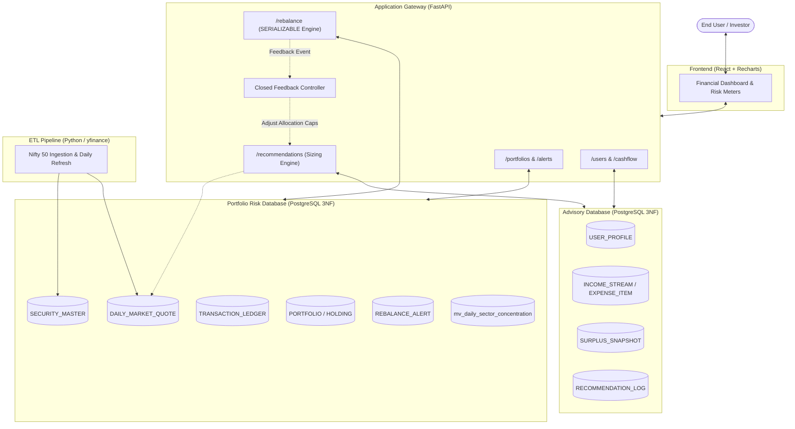

# IntelliVest

> **A Database-Centric, Closed-Loop Financial Platform Combining Affordability Profiling with Real-Time Portfolio Risk Analytics Run in PostgreSQL.**

---

## 🌟 Executive Summary

**IntelliVest** bridges the gap between personal cash-flow reality and live portfolio risk management. Unlike traditional advisory tools that issue decoupled stock recommendations or static risk reports, IntelliVest enforces an **affordability-first sizing constraint** and runs **real-time quantitative risk analytics natively inside PostgreSQL** using window functions and materialized views.

When portfolio risk thresholds are breached (e.g., Value-at-Risk spike, sector over-concentration via HHI), the platform closes the loop by automatically dynamically throttling subsequent recommendation sizing.

---

## 💡 Core Innovations & Pillars

1. **Affordability-First Recommendation Engine**: 
   - Evaluates gross income minus mandatory expenses to establish a *Computed Surplus*.
   - Deducts a liquid safety reserve to yield an *Investable Buffer*.
   - Strictly caps equity purchase allocations to whole round-lot shares within this surplus.
2. **In-Engine PostgreSQL Financial Analytics**:
   - Computes 30-day rolling volatility (`STDDEV`), 95% Parametric VaR, Historical VaR (`PERCENTILE_CONT(0.05)`), Sharpe Ratio, and Herfindahl-Hirschman Index (HHI) sector concentration directly in SQL without slow external ETL layers.
3. **Closed-Loop Feedback Controller**:
   - Continuous risk drift monitoring generates `REBALANCE_ALERT` events.
   - Triggers automated tightening or loosening of allocation caps in the Advisory engine.
4. **ACID-Guaranteed Rebalancing**:
   - Rebalancing transactions execute under strict `SERIALIZABLE` isolation to guarantee 0% write-skew anomalies during multi-asset rebalancing.

---

## 🏗 System Architecture



---

## 📁 Repository Structure

```text
.
├── backend/            # FastAPI Application Gateway & Business Routers
│   ├── config.py       # Configuration and Settings Loader
│   └── main.py         # App entrypoint and health status
├── db/                 # SQL Schemas, Migrations & Database Init Scripts
│   ├── init-scripts/   # Docker container initialization scripts
│   └── migrations/     # Advisory DB & Risk DB migration scripts
│       ├── advisory/
│       └── risk/
├── docs/               # Technical documentation, PRDs, and architecture specs
├── etl/                # Market data ingestion (yfinance / Nifty 50) & daily refresh
├── frontend/           # React Web Application (Vite + Modern UI)
├── tests/              # Test suite (pytest for backend/ETL/SQL validation)
│   ├── backend/
│   └── etl/
├── .env.example        # Environment variables template
├── docker-compose.yml  # Local multi-database PostgreSQL setup
├── pyproject.toml      # Python project specification and tool configuration
├── pytest.ini          # Pytest runner configuration
└── requirements.txt    # Python dependency manifest
```

---

## 🚀 Getting Started (Scaffolding Phase)

### 1. Prerequisites
- **Python 3.10+**
- **Node.js 18+** & **npm**
- **Docker** & **Docker Compose**

### 2. Environment Setup
Copy the example environment file:
```bash
cp .env.example .env
```

### 3. Spin Up PostgreSQL Databases
Start the dual PostgreSQL instances via Docker Compose:
```bash
docker-compose up -d
```
- **Advisory Database**: `localhost:5432` (`advisory_db`)
- **Portfolio Risk Database**: `localhost:5433` (`risk_db`)

### 4. Python Environment & Tests
```bash
# Create and activate virtual environment
python3 -m venv .venv
source .venv/bin/activate

# Install dependencies
pip install -r requirements.txt

# Run pytest suite
pytest
```

### 5. Frontend Setup
```bash
cd frontend
npm install
npm test
npm run dev
```

---

## 🗺 Implementation Roadmap

- **Phase 0**: Project Scaffolding & Setup *(Current)*
- **Phase 1**: PostgreSQL Schemas & Initial Migrations
- **Phase 2**: Market Data Ingestion Pipeline (yfinance / Nifty 50)
- **Phase 3**: In-Engine SQL Financial Analytics Validation
- **Phase 4**: Application Gateway & Closed Feedback Loop
- **Phase 5**: Dashboard UI & Final Integration
- **Phase 6**: Hardening & Polish
